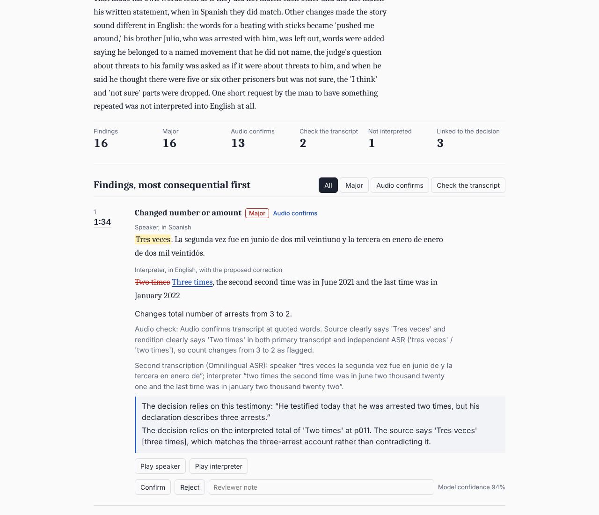
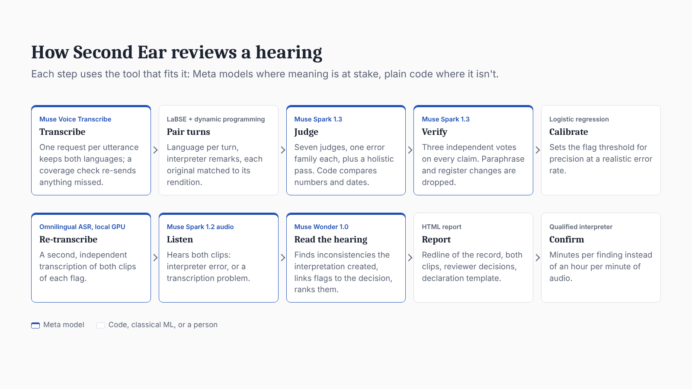

# Second Ear

An AI check interpreter for interpreted immigration hearings. Second Ear listens to the recording, compares what the respondent said with what the interpreter put on the English record, and returns ranked, specific discrepancies: a timestamp, the words spoken, the words interpreted, a proposed correction, and both audio clips, so a qualified interpreter can confirm each one in minutes.



## Why

- US immigration courts have 3,469,569 pending cases (EOIR, FY2026 Q3), and about 9 in 10 respondents need an interpreter.
- The record is the interpreter's English. If a number, date, or hedge changes, the transcript keeps the changed version.
- Appeals fail without specifics. In *Deh v. Blanche* (6th Cir. Apr 29, 2026), the claim failed because Deh "can't point to any specific mistranslations or mistakes by his interpreter," while the court noted he "could easily obtain the transcript and audio of his hearing."
- Finding those mistakes by hand takes a bilingual expert about an hour per minute of audio. No public error rate exists for US court or asylum interpreting.

Second Ear produces the evidence Deh lacked.

## What it finds

Omissions, additions, changed numbers, dates, ages, and names, reversed yes/no answers, dropped hedges, softened or intensified wording, pronoun shifts, legal terms, a question rendered as a different question, self-corrections left on the record, and exchanges never interpreted. Paraphrase, register, and first-person renditions are not flagged.

## How it works



| Step | Tool | Why this tool |
|---|---|---|
| Transcribe | Muse Voice Transcribe, one request per utterance | Keeps both languages of a code-switched hearing |
| Pair turns | LaBSE similarity + dynamic programming | Classical; no LLM needed |
| Judge | Muse Spark 1.3: 7 judges, one error family each, plus a holistic pass; code compares numbers and dates | Meaning errors need a language model |
| Verify | Muse Spark 1.3, 3 votes per claim | Drops paraphrase and register changes |
| Calibrate | Logistic regression on 8 features | A few hundred labels: classical ML fits |
| Re-transcribe | Omnilingual ASR CTC-1B (open weights, local GPU) | An independent second transcription |
| Listen | Muse Spark 1.2 audio on both clips of each flag | Separates interpreter errors from transcription errors |
| Read the hearing | Muse Wonder 1.0 (1M context) | Finds inconsistencies the interpretation created, links flags to the decision, ranks them |
| Report | Self-contained HTML | Redline of the record, both clips, reviewer decisions, declaration template |

## Results

Every test label was made by people (professional translators and language experts) and hash-locked before any run. Test sets ran once, at the freeze. Baselines got a revised prompt and medium reasoning. Hits are scored by time: a flag must land on the erroneous rendition (baselines get ±3 s).

**Long recordings with human labels (T4-test, locked: 832 pairs voiced as 4 sessions, 6.7 h)**

| System | Precision | Recall | F1 |
|---|---|---|---|
| **Second Ear** | **0.50** | **0.77** | **0.60** |
| One prompt, Muse Wonder 1.0 (whole recording) | 0.06 | 0.003 | 0.01 |
| One prompt, Muse Spark 1.2 (whole recording) | 0.20 | 0.002 | 0.005 |

By language, Second Ear's precision and recall: Mandarin 0.66 / 0.79, Hindi 0.68 / 0.50, Tamil 0.63 / 0.81, Spanish 0.35 / 0.89 (3.4 h). Median timestamp error: 0.13 s. Wonder returned no findings for the 3.4-hour Spanish session, and its Tamil answer was cut off.

**Mock hearings (dev: 30 sessions in 5 languages, 1.7 h, AI-written labels)**

| System | Precision | Recall | F1 |
|---|---|---|---|
| **Second Ear** | 0.75 | **0.95** | **0.84** |
| Second Ear, minus flags the audio check marks as transcription problems | 0.84 | 0.87 | 0.85 |
| One prompt, Muse Wonder 1.0 | 0.45 | 0.45 | 0.45 |
| One prompt, Muse Spark 1.2 | 0.25 | 0.21 | 0.23 |

Number and date recall: 0.98. The Wonder hearing pass linked 37 of 38 detected errors that a decision relied on (link precision 0.96), and ranked a decision-cited error first in 19 of 20 sessions.

**Where it does not win yet**

- **Text alone (T1-test, locked, 832 pairs):** when turns arrive already paired as text, our judges match one good prompt: F1 0.73 (judges + verifier) vs 0.73 (one prompt). The gain is end to end: pairing, long audio, timestamps, and evidence.
- **Clean real speech (T3, locked, 2.0 h of FLEURS voices with professional translations):** 88 false alarms per hour (73 after the audio check). Voice Transcribe caught only 31–45% of the English turns in these real, noisy recordings, so pairing broke and produced spurious omissions. Fixing segmentation on real audio is the first item of work.
- Self-corrections: recall 0.20 on dev.
- Precision on T1 is a lower bound: several "clean" pairs we flag are real errors the single rater missed.

API cost: about $5–7 per hearing hour.

## Live mode

`scripts/live.py` flags errors a few seconds after each rendition, for prep sessions where every participant consents to recording (Massachusetts requires all-party consent, G.L. c.272 §99) and for depositions noticed for recording (FRCP 30(b)(3)). It refuses to start without `--consent`. It is not for immigration court (8 CFR 1003.28; the EOIR Policy Manual bars AI note-taking apps) or USCIS interviews.

## Run it

Requires Python 3.12+, [uv](https://docs.astral.sh/uv/), ffmpeg, and a Meta Model API key in `.env` as `MODEL_API_KEY`. A CUDA GPU is optional (LaBSE and Omnilingual ASR run on CPU, slowly).

```
uv sync
uv run python scripts/review.py hearing.mp3 --lang es --title "Merits hearing" --decision decision.txt
```

The report is written to `data/reviews/<name>/report.html`. Live mode:

```
uv run python scripts/live.py --file prep_session.wav --lang es --consent
```

Evaluation: `scripts/run_text_eval.py`, `scripts/run_e2e.py`, `scripts/run_audio_baseline.py`, and `scripts/summarize.py`. Test sets rebuild from pinned public sources with `scripts/build_human_test.py`, `scripts/build_clean_sessions.py`, and `scripts/build_t4.py`; locks are in `eval/locks/`.

## Data

See [docs/data-card.md](docs/data-card.md). Third-party text and audio are never committed: the repo holds item IDs, labels, hashes, and the scripts that rebuild each set. The dev hearings are fictional and voiced with open TTS (Kokoro, Indic Parler-TTS). No real hearing records were used.

## Limitations

Our test labels come from public annotations by professional translators and language experts, not from interpreters reviewing hearing audio. Most of those errors occur in written news or machine translation, not live interpretation, because no permissively licensed, human-labeled interpreting data exists. Arabic and Portuguese have no human-labeled test data. A production service should validate on interpreted hearings labeled by certified court interpreters, with two independent annotators per hearing. We expect those manual labels to give more reliable, and likely lower, accuracy estimates than ours.

Second Ear produces leads for a qualified interpreter to verify. It is not a certified translation and not legal advice.
